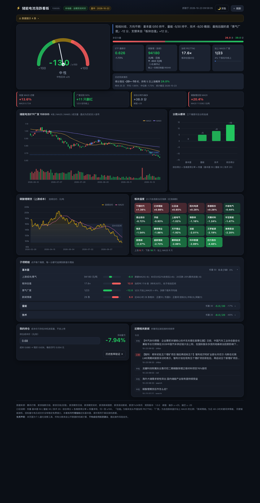

# ⚡ 储能电池涨跌看板（159305）

围绕你持有的 **储能电池ETF广发（159305）** 做的个人量化观察看板：把「基本面 / 量能 / 技术」三类信号综合成一个
**可解释的分数（-100 ~ +100）与信号灯（偏多 / 中性 / 偏空）**，并把每个子项的数值、得分与理由摊开给你看。

- **静态版（主用，零后端）**：托管在 GitHub Pages，手机/电脑打开网址就能用，数据由浏览器直接抓腾讯 / 新浪的公开接口。
- **本地版（辅用，含更多数据）**：`python3 local/server.py` 启动 Flask 看板，额外拿到碳酸锂期货**盘中实时价**与更完整的新闻情绪样本。

两端共用同一份规则文件 `shared/scoring_rules.json`，并有自动化测试保证「浏览器 JS」与「Python」打分结果完全一致。



> 同一套页面，右上角一键切换深色 / 浅色；窄屏自动单列排版（见 `docs/screenshots/dashboard-narrow.png`）。

---

## 1. 快速开始

### 本地版

```bash
python3 local/server.py          # 默认 http://127.0.0.1:8765 ，会自动打开浏览器
python3 local/server.py --port 9000 --no-open
```

首次加载约 3–5 秒（要抓 24 个标的的行情与日线）。页面右上角「强制刷新」可跳过 60 秒缓存。

### 静态版（GitHub Pages）

```bash
git init && git add -A && git commit -m "feat: 储能电池涨跌看板"
git remote add origin https://github.com/KurisuZhang/fund-board.git
git push -u origin main
```

然后在 GitHub 仓库 **Settings → Pages → Source: Deploy from a branch → main / (root) → Save**，
等 1–2 分钟访问 https://kurisuzhang.github.io/fund-board/ 。

> 仓库建议设为 **Public**（私仓用 Pages 需要付费 Pro）。持仓成本价保存在浏览器 `localStorage`，**不会进入仓库**。

### 测试

```bash
python3 -m pytest tests/ -q                 # 全部测试（90 个：口径 / 两端一致性 / 回测 / 静态链路 / UI 文案 / 动效）
python3 tests/gen_fixtures.py               # 改了打分规则后：重新生成 golden 期望值
python3 local/backtest_summary.py           # 重新生成「历史同类情形」快照（assets/fixtures/backtest_summary.json）
```

> JS/Python 一致性测试依赖 quickjs：`pip install --target .deps/quickjs quickjs`（未安装时相关测试自动 skip）。

---

## 2. 界面导览（看什么、怎么看）

页面从上到下是一套「先结论、再证据、最后明细」的顺序，全部由自动数据算出，没有手工录入项。

| 区块 | 内容 | 口径 |
|---|---|---|
| **刻度盘 + 一句话结论** | 综合得分（±100）与信号灯；下面是机械生成的文字结论，指出最强 / 最弱的子项 | 结论只是把分数翻译成中文，不含主观判断 |
| **多空力量条** | 所有子项的正分合计 vs 负分合计，一眼看出多空谁占上风 | 悬停可看贡献最大的三个子项 |
| **四个关键事实** | ETF 现价、碳酸锂连续合约（含较昨结算涨跌）、加权 PE、站上 MA20 的广度 | 涨跌配色固定「红涨绿跌」 |
| **历史同类情形** | 当前得分落在哪个 ±10 分桶，历史上该桶之后 5 日上涨概率 / 平均收益 / 样本数 | 快照来自 `local/backtest_summary.py`，静态版读仓库 JSON |
| **关键价位提示** | 收复 MA20 还需多少、广度回到 50% 需几只翻红、综合分转多的分差、碳酸锂回到 MA20 的距离 | 回答「什么情况下结论会翻转」 |
| **K 线主图** | 蜡烛图 + MA20/MA60 + 成交量副图 + 历史买入信号脉冲点 + **持仓成本虚线** | 支持滚轮缩放；成本线随输入实时移动 |
| **分数从哪来** | 瀑布图：三个维度各自加减多少，落到综合得分 | 负分向下、正分向上 |
| **碳酸锂 / 板块温度** | 上游期货走势（含 MA20 与近 60 日区间）；23 只自选股当日涨跌热力块 | 红涨绿跌，颜色越深幅度越大 |
| **子项明细** | 10 个子项逐个折叠展开：数值、双向得分条、得分、一句话理由 | 缺数据的子项标「缺失」并按权重归一 |
| **我的持仓** | 成本价输入 → 大号浮动盈亏；同一成本自动画进 K 线 | 只存 `localStorage`，不上传、不入库 |
| **近期新闻** | 近 48 小时相关新闻，带正面 / 中性 / 负面标签 | 关键词来自规则文件，按时间分组 |

### 主题与动效

- **双主题**：默认深色，右上角一键切换浅色，选择记在 `localStorage`（`sb_theme_v1`）；
  也可用 `?theme=light` 临时预览、`?cost=0.68` 临时带入成本价（都不会写回本地存储）。
- **动效原则**：入场 220–650ms、只用 `opacity` / `transform`；数字滚动、刻度盘指针、力量条、折叠面板都有过渡；
  动画只播一次（切换主题不会重播）；`prefers-reduced-motion` 下全部关闭；
  后台标签页里浏览器会节流 `requestAnimationFrame`，代码用定时器兜底，保证内容一定会显示出来。

---

## 3. 打分口径

总分 = Σ（维度得分率 × 维度权重），落在 ±100；权重与全部阈值都在 `shared/scoring_rules.json` 里，改完记得重跑 `gen_fixtures.py` 与 pytest。

**信号灯**：≥ +25 偏多（红）｜≤ −25 偏空（绿）｜区间内中性（黄）。

### 基本面 50（首要维度，全部自动化的**代理指标**）

| 子项 | 满分 | 口径 |
|---|---|---|
| 上游成本/景气 | 18 | 碳酸锂期货连续：站上/跌破 MA20（±6）；60 日分位（<20% → +6，>85% → −6）；20 日涨幅（+5%~+25% 温和回暖 +6；>25% 成本挤压 −4；<−15% 需求走弱 −6） |
| 板块估值 | 12 | 自选股总市值加权 PE(TTM)，剔除 PE≤0 与 >150：<18 → +12 … >60 → −12 |
| 景气广度 | 12 | 自选股收盘价站上 MA20 的比例：≥70% → +12 … <15% → −12 |
| 新闻情绪 | 8 | 近 48 小时相关新闻关键词净情绪（正面：招标/中标/装机/涨价/订单…；负面：降价/亏损/产能过剩/退坡…）；样本 <5 条判定「样本不足」并按缺失处理 |

> 「储能」「电池」这类行业名词**不**计入情绪词——否则每条相关新闻都会被判为正面。

### 量能 30（第二维度）

| 子项 | 满分 | 口径 |
|---|---|---|
| 成交额放大×方向 | 10 | 5 日均额 ÷ 20 日均额，结合同期涨跌方向查表（放量上涨 +10 … 放量下跌 −10） |
| 量价配合 | 8 | 近 10 日「涨跌方向 vs 成交额变化方向」一致比例，线性映射 ±8 |
| 收盘强度 | 6 | 收盘价在当日 [最低, 最高] 区间中的位置（近 3 日均值）→ ±6 |
| 突破确认 | 6 | 创 20 日新高且成交额 >1.3× 均额 → +6；创新低且放量 → −6 |

### 技术 20（辅助）

| 子项 | 满分 | 口径 |
|---|---|---|
| 均线结构 | 8 | MA5>MA20>MA60 → +8；多头但 MA20<MA60 → +4；空头排列 → −8 |
| MACD | 6 | DIF/DEA 与柱状变化四象限 → ±6 / ±3 |
| 位置 | 6 | RSI14 <30 → +6、>75 → −6；60 日乖离率 >12% 反向计分 |

---

## 4. 数据源与实测可用性（2026-10 实测）

| 用途 | 接口 | 浏览器（GitHub Pages） | Python 本地 |
|---|---|---|---|
| 行情快照（价格/PE/市值/成交额） | `qt.gtimg.cn` | ✅ CORS `*` | ✅ |
| 个股/ETF 日线（前复权） | `web.ifzq.gtimg.cn` | ✅ CORS（偶发 501 限流 → 自动回落新浪） | ✅ |
| 指数长历史日线 | 新浪 `jsonp_v2` / `json_v2` | ✅ JSONP | ✅ |
| 碳酸锂期货日线 | 新浪 `jsonp.php` | ✅ JSONP | ✅ |
| 碳酸锂期货**盘中实时价** | 新浪 `hq.sinajs.cn` | ❌ 对 `github.io` 来源 403 | ✅（带 Referer） |
| 关键词新闻搜索 | 新浪 `search.sina.com.cn/api/search` | ❌ 无 CORS、不支持回调 | ✅ |
| 滚动新闻 / 7×24 快讯 | 新浪 `feed.mix` / `zhibo` | ✅ JSONP | ✅ |
| 东方财富全线 | `push2.eastmoney.com` | — | ❌ 本机空响应，**整体不依赖** |

### 已知局限（务必知悉）

1. **基本面是代理指标**：真实的月度储能装机（GWh）、招标量、电芯成交价没有稳定的免费接口，本看板用「上游期货 + 板块估值 + 广度 + 新闻情绪」近似，不等于真实装机数据。
2. **静态版新闻情绪常缺失**：浏览器端拿不到关键词搜索接口，「滚动新闻 + 快讯」在几小时内几乎不会出现储能相关标题，通常命中不足 5 条 → 该子项标记「缺失」并按权重归一。需要完整情绪样本请用本地版（同日实测 20+ 条）。
3. **静态版期货无盘中价**：用日线最新收盘代替，页面已标注「日线口径」。
4. **PE 分位暂不可回溯**：只能取到当期快照，估值分位需要长期积累；本地版每次运行会写入 `data/history.db` 供将来使用。
5. **除权修复**：ETF 于 2026-05-21 发生份额拆分（2.203 → 1.058）。新浪不复权序列会造成 −52% 假跌，代码自动识别并前复权修复（修复后与国证储能电池指数 980027 的日收益相关性 0.982）。

---

## 5. 目录结构

```
├─ index.html              静态看板（GitHub Pages 入口）
├─ backtest.html           历史胜率验证页
├─ assets/
│   ├─ datafeed.js         浏览器抓数：腾讯 fetch + 新浪 JSONP + 并发限流 + 除权修复
│   ├─ indicators.js       MA / EMA / MACD / RSI / 分位（与 indicators.py 对应）
│   ├─ scoring.js          打分引擎（读 shared/scoring_rules.json）
│   ├─ app.js              看板编排：结论区 / 关键价位 / 明细 / 持仓 / 新闻
│   ├─ charts.js           ECharts 图表：K线+量能+信号、维度瀑布、碳酸锂（主题自适应）
│   ├─ motion.js           动效工具：数字滚动、错峰入场、降级与 rAF 兜底
│   ├─ theme.js            深色 / 浅色主题切换与持久化
│   ├─ style.css           设计系统：双主题令牌 + 响应式 + prefers-reduced-motion
│   ├─ backtest.js         浏览器版回测
│   ├─ selftest.html       浏览器内自检：对比 golden.json 期望值
│   ├─ vendor/echarts.min.js
│   └─ fixtures/           golden.json + sample_input.json + backtest_summary.json（历史胜率快照）
├─ shared/scoring_rules.json   权重、阈值、自选股、关键词——两端唯一口径
├─ local/
│   ├─ server.py           Flask：/、/api/dashboard、/api/config、/api/backtest、/api/history
│   ├─ datafeed.py         抓数（含期货实时价、除权修复、新浪回落）
│   ├─ indicators.py  scoring.py  backtest.py  store.py
│   ├─ backtest_summary.py 逐日打分 → 未来 5 日收益 → 分桶胜率（生成静态快照）
├─ docs/screenshots/       README 用的页面截图（深色 / 浅色 / 窄屏）
├─ tests/                  pytest：指标、打分边界、两端一致性、回测、静态链路仿真、UI 文案、动效
├─ data/                   运行时缓存与 sqlite（已 .gitignore）
└─ .nojekyll  README.md  .gitignore
```

---

## 6. 怎么改

- **改阈值/权重/自选股**：编辑 `shared/scoring_rules.json` → `python3 tests/gen_fixtures.py` → `python3 -m pytest tests/ -q`。
- **改界面**：`index.html` + `assets/style.css` + `assets/app.js`（结构与文案）、`assets/charts.js`（图表）；改完跑 `tests/test_motion.py` 与 `tests/test_ui_logic.py` 兜口径与动效约束。
- **更新历史胜率**：`python3 local/backtest_summary.py` 会重算分桶写回 `assets/fixtures/backtest_summary.json`（静态版依赖它）。
- **改打分逻辑**：同时改 `local/scoring.py` 与 `assets/scoring.js`（两边逐行对应），再跑 pytest —— `test_parity.py` 会用 quickjs 执行 JS 并与 Python 比对，防止两端漂移。
- **换标的**：把 `instruments.etf` 改成别的代码即可（自选股可换成你关心的板块）。

---

## 7. 免责声明

本看板是个人量化观察工具，所有分数均由公开数据的机械规则算出，**不构成任何投资建议**。
免费接口可能限流、变更或失效；历史胜率不代表未来表现。据此操作，风险自负。
